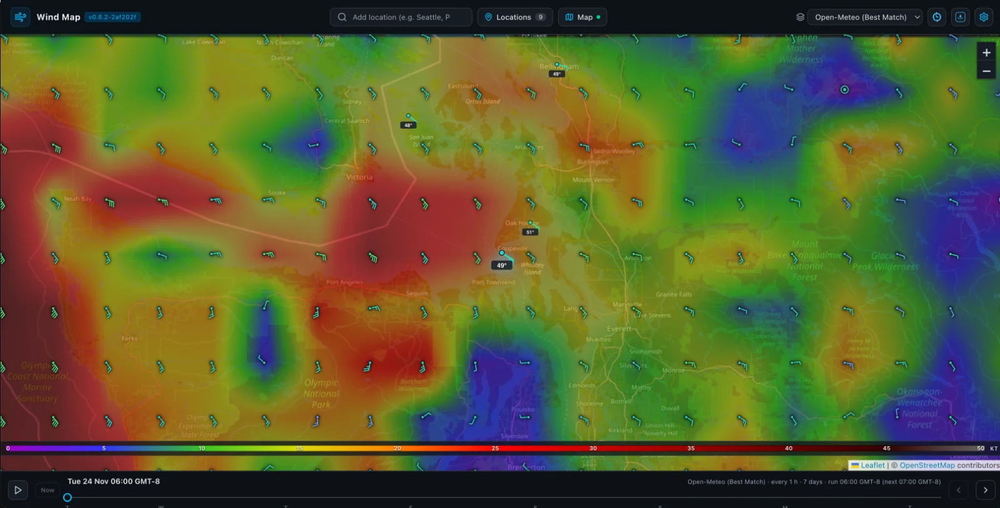

# Wind Map 🌬️🗺️

A standalone, minimalist dark-mode application that displays live weather forecasts and meteorological wind barbs on an interactive map.

Built with **FastAPI (Python 3.14)** on the backend and **React + Vite + Leaflet + TailwindCSS** on the frontend, packaged in a self-contained multi-stage Docker container.



*Wind grid barbs, temperature-coloured barbs, the wind colour gradient and the forecast time selector, at 06:00 PST.*

---

## Features

- **Interactive Map:** Powered by Leaflet.js with CartoDB Dark Matter tiles.
- **Meteorological Wind Barbs:** Custom SVG markers displaying wind direction and speed feathers (calm circles, 5kt half-barbs, 10kt full-barbs, 50kt pennants) with temperature-based color coding.
- **Wind Grid Overlay:** A continuous grid of wind barbs covering the entire visible viewport, drawn and temperature-colored the same way as the saved-location barbs. Speed is shown by the number of barbs (5 kt half barb, 10 kt full barb, 50 kt pennant; calm is a circle). Grid density targets one barb per ~80px and auto-adjusts on pan/zoom. Toggled via Map Settings (default: on).
- **Wind Color Gradient:** A smooth color field for wind speed drawn under the barbs, from the same grid fetch the barbs use, with bilinear interpolation and the legend's exact color stops (0 kt purple → 5 blue → 10 green → 15 yellow → 20 orange → 25 red → 40/45 dark red → 50+ gray). A full-width legend above the map attribution labels the scale in your speed unit, and barbs gain a dark halo so their temperature colors stay readable. Toggled separately from the barbs in Map Settings (default: off).
- **Water Currents:** A grid of chevrons over the water, pointing where the surface current flows and coloured by speed — light (under 0.5 kt), moderate (0.5–1.5 kt), strong (1.5–3 kt) and extreme (3 kt and above). A chevron is drawn only where the point is at sea, so the land stays clear; clicking one opens a pop-up with its speed, compass direction and where it flows toward, in your units, naming the source and the selected forecast hour. The field comes from Open-Meteo Marine (Copernicus Marine, ~8 km), is independent of the selected weather model, follows the same forecast-time selector on its own 240-hour horizon, and retries and the quota 503 behave exactly as on the wind grid. Toggled in Map Settings (default: off); with it on, a compact key at the map's top-left lists the four tiers with their ranges in your speed unit.
- **Clickable Barbs:** Clicking any grid barb selects it — drawn larger with a white highlight ring — and opens a small pop-up with that point's wind speed, direction and temperature in your units, without saving it as a location and without another request — useful over open water where no place name exists. Clicking a saved location marker switches back to that location's highlight and pop-up.
- **Forecast Time Selector:** a bar under the map names the selected model with its update cadence, time horizon and last/next run time (for example `NOAA GFS Seamless · every 6 h · 16 days · run 12:00 UTC (next 18:00)`), and runs a track from now to that horizon with day labels, a "now" marker and a handle that moves in 1-hour steps. Drag or click the track, use the arrows, the keyboard (←/→ step, Home/End jump, Space plays) or play-pause (3 hours per tick, waiting for each step's data); Now returns to live values. Moving it redraws the barbs, the saved-location markers and the colour gradient for that hour, and both pop-ups name it. The selected hour is memory-only: the app opens at "now".
- **Map export:** the download-icon button in the top bar, immediately left of the Preferences gear, opens an export dialog for the view on screen — PNG or JPEG at 2x (with a quality choice for JPEG), or a single-page PDF on Letter or A4 in portrait or landscape, fitted to the page with its aspect ratio kept. Every file carries a header (the hour shown in your timezone and in UTC, the model and its run, the capture time), a legend and a footer (units, the base-map attribution and the app version). With the wind colour gradient on, the legend draws the same wind-speed scale as the strip on screen (same colours and tick labels in your speed unit) and the barb row is captioned "colour = temperature"; with it off the legend keeps the barb feathers and the six temperature bands. Leaflet controls and pop-ups are left out, the dialog previews the file name (named after the model and hour, e.g. `ecmwf_ifs_2026-11-18_1400PST.pdf`, falling back to `wind-map_...` for an unknown model), and the capture library and jsPDF load only when you export. The dialog is titled "Download map image", uses the download artwork in its header, and lets you edit the file name before exporting: the extension follows the format and reserved characters are removed. It also has a **Range** mode: pick a start hour, an end hour and an interval (1, 2, 3, 6 or 12 h) inside the model's forecast window, see a summary such as "5 captures from Mon 14:00 to Mon 18:00 PST" and a 24-capture cap, then capture one frame per hour with that hour's data and header. Progress shows "n of N" with a Stop capturing button; cancelling downloads nothing, and a failure names the hour and offers the frames captured so far. A range saves as **one ZIP** of PNG or JPEG images (one file per hour, named after its hour) or **one multi-page PDF** with a page per hour on Letter or A4 in either orientation; a single-hour range downloads that image directly. Both formats are named after the model, the first hour and the frame count (e.g. `best_match_2026-11-23_1400PST_5hours.zip`), PDF pages keep the single-page margins and aspect ratio, and the ZIP and PDF libraries load only for those formats. The 24-capture cap keeps a full range's pages in memory until the PDF is saved.
- **Forecast-time data:** the weather endpoints accept an hour-aligned `time` for any hour from now up to the selected model's horizon (7 days for Open-Meteo Best Match, 15 for ECMWF IFS, 16 for NOAA GFS, 7.5 for DWD ICON), and `/api/weather/models` reports each model's update cadence, horizon and last/next run time. `MapView` and the grid hook take the resulting `validTime`, which the selector above sets; without a selection the app shows current conditions.
- **Multiple Weather Models:** Dropdown selector supporting:
  - *Open-Meteo (Best Match)* (default)
  - *ECMWF IFS 0.4°*
  - *NOAA GFS Seamless*
  - *DWD ICON Seamless*
- **Weather Model Guide:** a refresh-icon button beside the model selector opens a reference table of the supported models with their update cadence, time horizon and run times, bundled at build time from `frontend/src/assets/weather-models.md`.
- **Autocomplete Location Search:** Verified geocoding lookup via Open-Meteo Geocoding API with state/region and country disambiguation.
- **Location Management:** Saved locations modal with instant selection and minus (`-`) buttons for removal.
- **Preferences Pop-up:** A gear icon in the top bar opens Preferences: timezone, temperature (°F / °C), wind speed (knots, km/h, mph, m/s) and wind direction display (barbs, cardinal directions, degrees). Each setting is independent (°F/°C changes only the temperature unit) and is saved in the browser, so it survives a reload.
- **Timezone Support:** Pacific Time by default, with quick switching across major world timezones from Preferences.
- **SQLite Persistence & Caching:** Forecast data is cached locally for 30 minutes (TTL) to ensure rapid response times (<3s SLA) and minimize external API calls. A forecast-hour grid request also stores every hour of that UTC day, so range exports reuse one upstream call per day, and transient Open-Meteo 429/5xx responses are retried with `Retry-After` or a short backoff instead of failing the request.
- **Quota Warning:** when Open-Meteo's daily request limit is reached (a persistent 429 after the retries), the grid endpoint answers `503` with the reset instant, and the app shows a dismissible warning naming when wind data should return in your timezone (e.g. `4:00 PM PST`). It appears once per reset window, so panning does not reopen a dismissed warning, and later pan or view changes recover on their own once the quota is back.
- **Default / Fallback Location:** Automatically attempts browser geolocation; defaults to Oak Harbor, Washington (`48.2939° N, 122.6064° W`) if permission is denied or on fresh launch.

---

## Architecture

```
wind-map/
├── Dockerfile                   # Multi-stage build (Node build -> Python deps -> Alpine runtime)
├── docker-compose.yml           # Optional compose configuration
├── requirements.in / .txt       # Pinned runtime dependencies (pip-compile)
├── requirements-dev.in / .txt   # Pinned test tools
├── VERSION                      # Release version, shown in the navbar and /api/health
├── docs/screenshot.png          # Screenshot shown above
├── release-notes/               # One notes file per release (x-x-x.md)
├── scripts/                     # rebuild-container.sh, sync-ai-rules.py
├── .kiro/steering/              # AI coding rules (source of truth)
├── backend/
│   ├── app/
│   │   ├── main.py              # FastAPI application, /api/health, /api/config & static asset server
│   │   ├── config.py            # Settings & named constants (models, horizons, forecast shape, limits, timeouts)
│   │   ├── database.py          # All table definitions, versioned migrations (PRAGMA user_version) & seed
│   │   ├── locations_repo.py    # Data access for saved locations
│   │   ├── dependencies.py      # Shared query params (model validation, timezone)
│   │   ├── units.py             # Unit conversions & cache-key rounding
│   │   ├── models.py            # Pydantic data schemas
│   │   ├── routers/             # API endpoints (locations, weather, grid, currents, geocode, feedback)
│   │   └── services/            # open_meteo.py (shared HTTP client, retries, quota reset); weather_service.py
│   │                            # (cache → fetch → parse → store), forecast_parser.py (pure parsing),
│   │                            # forecast_cache.py (saved-location, point & grid-day caches),
│   │                            # grid_weather_service.py, currents_service.py (marine grid & point),
│   │                            # geocode_service.py, jira_service.py & feedback_limiter.py (in-app feedback), model_info.py (run times,
│   │                            # horizons), time_window.py (forecast-hour validation)
│   └── tests/                   # Backend pytest suite (conftest.py fixtures, factories.py builders)
└── frontend/
    ├── src/
    │   ├── components/          # Navbar, MapView, WindOverlay, WindColorOverlay, WindColorLegend, WindBarb,
    │   │                        # CurrentOverlay, CurrentLegend, WaterCurrentChevron,
    │   │                        # ForecastTimeSelector, MapExportControl, MapExportDialog and its fields
    │   │                        # (ExportModeField, ExportRangeFields, ExportFormatFields, ExportRangeStatus,
    │   │                        # mapExportOptions.ts), MapSettingsModal, PreferencesModal,
    │   │                        # SavedLocationsModal, WeatherModelGuideModal, QuotaWarningDialog, FeedbackModal, mapTiles.ts
    │   ├── hooks/               # useSettings.ts (map settings, unit preferences, timezone), useLocations.ts,
    │   │                        # useForecast.ts (useAllWeather), useWindGrid.ts, useCurrentGrid.ts (240 h guard,
    │   │                        # abort, silent failure), useMapExport.ts (capture & ranges),
    │   │                        # useLocalStorageState.ts, useLatest.ts
    │   ├── api/                 # Typed API client (one request() helper, ApiError, quota parsing)
    │   ├── utils/               # units.ts (display formatting), forecastWindow.ts (selector maths),
    │   │                        # mapExport.ts (image header/legend/name), captureMap.ts (composition),
    │   │                        # captureDom.ts (tiles & capture filter), captureChrome.ts (header/legend/footer),
    │   │                        # download.ts (encode & save), pdfExport.ts (PDF page fitting),
    │   │                        # exportRange.ts (range planning),
    │   │                        # rangeCapture.ts (per-hour capture), rangeOutput.ts (ZIP & multi-page PDF),
    │   │                        # windColorScale.ts (shared gradient stops), windBarb.ts (feather maths),
    │   │                        # currentTiers.ts (tier table behind chevrons and legend),
    │   │                        # modelGuide.ts (model table), html.ts (escaping)
    │   ├── test/                # Shared Leaflet mock, fixtures, test setup
    │   ├── assets/              # weather-models.md, icon artwork
    │   ├── constants.ts         # Defaults, timezone list, storage keys
    │   ├── types.ts             # TypeScript interfaces
    │   ├── version.ts           # Injected __APP_VERSION__
    │   └── App.tsx              # Wires the hooks to the components
    ├── appVersion.ts            # Reads VERSION and GIT_SHA for the build
    ├── package.json             # React, Leaflet, TailwindCSS, Vite
    └── vite.config.ts           # Dev proxy configuration
```

---

## Quick Start with Docker

### 1. Build the Docker Image

```bash
docker build -t wind-map .
```

### 2. Run the Container with Persistent Storage

```bash
docker run -d -p 5005:5005 -v wind_data:/app/data --name wind-map wind-map
```

*(Optional: Pass your free CARTO API key to unlock watermark-free CARTO Dark Matter)*:
```bash
docker run -d -p 5005:5005 -e CARTO_API_KEY="$CARTO_API_KEY" -v wind_data:/app/data --name wind-map wind-map
```

*(Optional: Enable the in-app feedback button, which files Jira issues through one service account)*:
```bash
docker run -d -p 5005:5005 \
  -e JIRA_BASE_URL="https://nehes.atlassian.net" \
  -e JIRA_EMAIL="$JIRA_EMAIL" \
  -e JIRA_API_TOKEN="$JIRA_API_TOKEN" \
  -e JIRA_FEEDBACK_PROJECT="SCRUM" \
  -v wind_data:/app/data --name wind-map wind-map
```
Keep the email and token in your shell environment or a secret store, never in the repository. Without all three of `JIRA_BASE_URL`, `JIRA_EMAIL` and `JIRA_API_TOKEN` the button is hidden and `POST /api/feedback` returns 503. `FEEDBACK_MAX_PER_HOUR` (default 5) caps submissions per client IP.

Open your browser at **[http://localhost:5005](http://localhost:5005)**.

---

### Map Layers & CARTO API Key

- **OpenStreetMap Dark (Default):** the same OpenStreetMap tiles, darkened in CSS, so it needs **no API key** and has no watermarks.
- **OpenStreetMap Standard:** the plain OSM style, for when the dark base map hides a feature.
- **CARTO Dark Matter:** CARTO requires a free API key to remove their *"API KEY REQUIRED"* watermark.
  1. Visit **[carto.com/basemaps/apikey](https://carto.com/basemaps/apikey)** to get an instant free key (up to 5 million requests/month).
  2. Click the **Map** button in the app's top bar to paste and save your key directly in the UI, or pass it via `CARTO_API_KEY` environment variable.

To stop the container:
```bash
docker stop wind-map && docker rm wind-map
```

### Password Protection and Litestream Replication

The container is ready for the public Google Cloud Run deployment (`SCRUM-133`). Two environment
variables control that mode; neither is needed for local use.

- **`APP_PASSWORD`** turns on HTTP Basic authentication for every route except `GET /api/health`.
  The username is ignored and one password is shared. Unset (the default) means open access, so
  `docker run`, `npm run dev` and the test suite behave exactly as before. The container never logs
  the password or the `Authorization` header.
- **`LITESTREAM_BUCKET`** turns on Litestream, which replicates `/app/data/wind_map.db` to that GCS
  bucket (`litestream.yml`) and restores it when a new instance starts with no database
  (`scripts/docker-entrypoint.sh`). Unset, the entrypoint runs Uvicorn directly.

```bash
# Local container with a password, no replication
docker run -d -p 5005:5005 -e APP_PASSWORD="$APP_PASSWORD" -v wind_data:/app/data --name wind-map wind-map
```

Google Cloud authentication for the bucket comes from Application Default Credentials of the
runtime service account; no key file is baked into the image.

### Google Cloud Infrastructure

`scripts/gcp-provision.sh` creates the stage-2 resources in project `wind-app-515017` (SCRUM-135).
It is idempotent, so running it again changes nothing and never rotates the stored password.

```bash
scripts/gcp-provision.sh                      # generates the shared password
APP_PASSWORD='...' scripts/gcp-provision.sh   # or uses a password you choose
CARTO_API_KEY='...' scripts/gcp-provision.sh  # optional, stores the CARTO key too
```

It provisions:

- the private bucket `gs://wind-map-litestream-wind-app-515017` in `us-west1`, with uniform
  bucket-level access, public access prevention and a 7-day abort of unfinished uploads;
- the Secret Manager secret `APP_PASSWORD` (and `CARTO_API_KEY` when a value is supplied);
- the service account `wind-map-runner@wind-app-515017.iam.gserviceaccount.com`, with
  `roles/storage.objectAdmin` on the bucket and `roles/secretmanager.secretAccessor` on the secrets.

It finishes by impersonating that service account to write, read and delete a probe object in the
bucket and to read `APP_PASSWORD`, which is the access the deployed container gets. For that check
the script grants your own account `roles/iam.serviceAccountTokenCreator` on the runner; the deployed
container does not use it. The password is never printed; read it with:

```bash
gcloud secrets versions access latest --secret=APP_PASSWORD --project=wind-app-515017
```

### Google Cloud Run Deployment

The public deployment runs the same image on Cloud Run behind HTTP Basic Auth, with SQLite
replicated to the bucket above (SCRUM-136). It is live at
<https://wind-map-qhtz2eay6a-uw.a.run.app> (username ignored, password from Secret Manager).

```bash
# Build for Cloud Run's architecture in Cloud Build and push the release tag and latest.
gcloud builds submit --project=wind-app-515017 --config=cloudbuild.yaml \
  --substitutions=_TAG=$(cat VERSION)-$(git rev-parse --short HEAD),_GIT_SHA=$(git rev-parse --short HEAD)

# Deploy: one instance with CPU always allocated so Litestream keeps replicating.
gcloud run deploy wind-map --project=wind-app-515017 --region=us-west1 \
  --image="$IMAGE:latest" --port=5005 \
  --service-account=wind-map-runner@wind-app-515017.iam.gserviceaccount.com \
  --memory=512Mi --max-instances=1 --min-instances=0 --no-cpu-throttling \
  --allow-unauthenticated \
  --set-env-vars=LITESTREAM_BUCKET=wind-map-litestream-wind-app-515017 \
  --set-secrets=APP_PASSWORD=APP_PASSWORD:latest
```

Cloud Build runs natively on amd64; locally, `docker buildx build --platform linux/amd64` with the
same `--build-arg GIT_SHA` produces the same image, but pushing 50 MB of layers from a slow uplink
tends to time out, so Cloud Build is the supported path.

Cloud Run must allow unauthenticated requests so the app can answer with its own Basic Auth
challenge; IAM is not the gate. Without `APP_PASSWORD` the same command would publish an open site,
so the secret is part of the deployment, not an option.

**Single writer.** Litestream replicates one database and assumes one writer, so the service is
capped at one instance (`--max-instances=1`) with CPU always allocated (`--no-cpu-throttling`).
Scaling to zero is safe: the next instance restores the database from the bucket before serving,
and the entrypoint creates the schema when neither a local database nor a replica exists yet.

**Verify the deployment.**

```bash
URL=$(gcloud run services describe wind-map --region=us-west1 --format='value(status.url)')
curl -s -o /dev/null -w '%{http_code}\n' "$URL/api/health"   # 200, no credentials
curl -s -o /dev/null -w '%{http_code}\n' "$URL/"             # 401
curl -s -u "wind-map:$(gcloud secrets versions access latest --secret=APP_PASSWORD)" \
  -o /dev/null -w '%{http_code}\n' "$URL/"                   # 200
```

To prove persistence, create a location and then replace the instance (a revision-level change such
as `--update-env-vars`), and check that `GET /api/locations` still returns it; the new instance has
an empty disk and must restore the database from GCS.

**Rollback.** Every deployment creates a revision; move traffic back, or redeploy the previous tag.

```bash
gcloud run revisions list --service=wind-map --region=us-west1
gcloud run services update-traffic wind-map --region=us-west1 \
  --to-revisions=wind-map-00001-abc=100        # the revision to go back to
gcloud run services update-traffic wind-map --region=us-west1 --to-latest   # back to the newest
```

A CARTO key is optional. To add it later, create the secret (`CARTO_API_KEY`), grant the runner
`roles/secretmanager.secretAccessor` on it, and add `CARTO_API_KEY=CARTO_API_KEY:latest` to
`--set-secrets`; without it the map uses the OpenStreetMap tiles.

---

## Local Development Setup

Requires **Node 24** (`frontend/package.json` `engines`) and **Python 3.14** — the same versions CI and the Docker image use.

### Backend (Python)

1. Create and activate a virtual environment:
   ```bash
   python3 -m venv .venv
   source .venv/bin/activate
   ```
2. Install dependencies:
   ```bash
   pip install -r requirements-dev.txt
   ```
   (`requirements.txt` holds pinned runtime dependencies only and is what the Docker image installs; `requirements-dev.txt` adds the pinned test tools.)

#### Updating Python dependencies
`requirements.txt` and `requirements-dev.txt` are generated and pinned with `==`, so every build installs the same versions, and the top-level `requirements.in` and `requirements-dev.in` are pinned to exact versions too: no `>=` ranges, so a rebuild never resolves something newer than what was tested. Do not edit the generated files by hand. To add or upgrade a package, change the exact version in `requirements.in` (runtime) or `requirements-dev.in` (tests), then regenerate in the same Python and OS as the Docker image, run the tests, and commit all changed files:
```bash
docker run --rm -v "$PWD":/w -w /w python:3.14-alpine sh -c \
  "pip install -q pip-tools && \
   pip-compile -q --strip-extras --annotation-style=line -o requirements.txt requirements.in && \
   pip-compile -q --strip-extras --annotation-style=line -o requirements-dev.txt requirements-dev.in"
```
To upgrade everything to the latest allowed versions, add `--upgrade` to both `pip-compile` commands.
3. Run backend tests:
   ```bash
   pytest backend/tests
   ```
4. Start development backend server:
   ```bash
   uvicorn backend.app.main:app --reload --port 5005
   ```

### Frontend (Node.js)

1. Navigate to `frontend/`:
   ```bash
   cd frontend
   npm install
   ```
2. Start Vite development server:
   ```bash
   npm run dev
   ```
3. Open **http://localhost:5173** (API requests are automatically proxied to port 5005).

Cross-origin API access is off by default. If you call the API from another origin, set `CORS_ORIGINS` (comma-separated), e.g. `CORS_ORIGINS=http://localhost:3000`.

---

## REST API Reference

| Method   | Endpoint              | Description                                          |
| -------- | --------------------- | ---------------------------------------------------- |
| `GET`    | `/api/health`         | Health check endpoint                                |
| `GET`    | `/api/config`         | Public frontend config (a server-side CARTO key, when set, and `feedback_enabled`) |
| `GET`    | `/api/locations`      | List all saved locations                             |
| `POST`   | `/api/locations`      | Save a new verified location                         |
| `DELETE` | `/api/locations/{id}` | Delete a saved location                              |
| `GET`    | `/api/weather/models` | List models with update cadence, horizon and run times |
| `GET`    | `/api/weather`        | Get 48h forecast & current conditions for a location |
| `GET`    | `/api/weather/all`    | Get current conditions (or one forecast hour) for all saved locations |
| `GET`    | `/api/weather/point`  | Get 48h forecast for an arbitrary lat/lon point (no saved location needed) |
| `GET`    | `/api/weather/grid`   | Get wind for a lat/lon bounding box grid, now or at a forecast hour (powers the barb overlay) |
| `GET`    | `/api/currents/grid`  | Get surface current for a lat/lon bounding box grid, now or at a forecast hour (powers the currents overlay) |
| `GET`    | `/api/currents/point` | Get the 240-hour surface-current series for an arbitrary lat/lon point |
| `GET`    | `/api/geocode?q=...`  | Autocomplete search for cities & coordinates         |
| `POST`   | `/api/feedback`       | File in-app feedback as a Jira issue (needs the Jira variables below; 503 otherwise) |
| `GET`    | `/docs`               | Interactive Swagger / OpenAPI documentation          |

The weather endpoints accept `model` (one of the ids from `/api/weather/models`; anything else is a 422) and `timezone` (IANA name, default `America/Los_Angeles`). Open-Meteo failures return 502 with a short message; details are in the server log.

The exception is exhausted quota. When Open-Meteo keeps answering 429 after the retries, `/api/weather/grid` returns **503** with `{"code": "open_meteo_quota_exhausted", "message": ..., "reset_at": <ISO 8601 or null>}` and, when the reset instant is known, a `Retry-After` header with the seconds remaining. The frontend turns that into the quota warning described above.

`/api/weather`, `/api/weather/all`, `/api/weather/point` and `/api/weather/grid` also accept an optional `time`: an ISO 8601, hour-aligned instant with an offset (e.g. `2026-11-23T12:00:00Z`). It must fall between the current hour and the selected model's horizon; otherwise the response is 422 with a message naming the limit. Omit it for live `current` conditions, which is what the app still requests. With `time`, `current` describes that hour (and `valid_time` repeats it), grid points carry their hour in `time`, and both the grid and forecast caches are keyed by hour.

`/api/currents/grid` and `/api/currents/point` take the same bounding box or coordinates and the same optional `time`, but no `model`: currents come from a single field (Open-Meteo Marine, Copernicus Marine) whose 240-hour horizon does not depend on the selected weather model, and a `time` beyond it is a 422 naming that limit. Land points are left out of a grid response — an inland box answers `{"points": []}` — and are cached along with the water ones, so panning back inland does not repeat the upstream call.

---

## Versioning

The app version follows the release version. The `VERSION` file in the project root (e.g. `0.8.2`) is the single source of truth: the backend reports it from `GET /api/health` and the API docs, and the navbar shows it. For each release `vX.Y.Z`, update `VERSION` and `frontend/package.json` to `X.Y.Z` before tagging:

```bash
echo "X.Y.Z" > VERSION
(cd frontend && npm version X.Y.Z --no-git-tag-version --allow-same-version)
```

Tests fail if the two files disagree.

The displayed version also carries the short commit hash, e.g. `v0.8.2-2af202f` in the navbar and `"version": "0.8.2-2af202f"` from `/api/health`, so a running build can be traced to a commit. `VERSION`, `frontend/package.json` and release tags stay plain `X.Y.Z` / `vX.Y.Z`; the hash is build metadata. `scripts/rebuild-container.sh` passes it as the `GIT_SHA` build arg (the `Dockerfile` gives it to the Vite build and the backend); a local frontend build falls back to `git rev-parse --short HEAD`, and a build with no hash shows plain `X.Y.Z`. When the user asks for a build to test, bump the last digit as well (`0.8.2` -> `0.8.3`): that is not a release, so it needs no release notes or tag.

Every release also ships release notes in `release-notes/x-x-x.md` (dots replaced by hyphens, e.g. `0-8-2.md`), committed with the version bump and used for the GitHub release.

---

## AI coding rules

`.kiro/steering/*.md` is the single source of truth for the project rules. `python scripts/sync-ai-rules.py` renders them for every agent, and the generated files must not be edited by hand: a pytest test fails when one is stale or over budget. The rules are tiered because Devin Desktop auto-injects only the first 16 KiB of `AGENTS.md`:

- **Always on — `AGENTS.md`** (Devin and Freebuff): the hard guardrails only, held to **14,000 bytes** so a new rule has headroom instead of landing on the truncation edge. It ends with pointers to the situational files.
- **Situational — `.devin/rules/*.md`** (Devin): one generated file per situational steering file, with `trigger: glob` front matter and a 12,000-character cap each, so Devin loads the testing or release rules only when a matching file is in play. To add one, list the steering file in `SITUATIONAL` in the sync script.
- **Complete body — `GEMINI.md`, `.config/antigravity/instructions.md` and `.freebuff/rules.md`:** those tools do not share Devin's 16 KiB cap, so they get every rule; the Freebuff file also lists the skills, the situational rules and the hooks.

To change a rule, edit `.kiro/steering/`, run `python scripts/sync-ai-rules.py`, and commit the steering change with the regenerated `AGENTS.md`, `GEMINI.md`, `.config/antigravity/instructions.md`, `.freebuff/rules.md` and `.devin/rules/`.

---

## Testing

Backend test suite coverage includes:
- Health check verification
- Database seeding with default location (Oak Harbor, WA)
- Location CRUD lifecycle (create, duplicate detection, delete)
- Open-Meteo weather forecast retrieval (16 data points over 48 hours)
- 30-minute SQLite caching verification (<0.5s response time on cache hit)
- Mathematical conversion helpers (wind speed units, temperature, cardinal degrees)
- Point weather endpoint — arbitrary lat/lon forecast with correct N/S/E/W name formatting and coordinate validation
- Wind grid endpoint — bounding box grid generation, per-point caching, batch Open-Meteo fetch, bbox/dimension validation, and one upstream call per UTC day for an hour range
- Wind grid endpoint — bounding box grid generation, per-point caching, batch Open-Meteo fetch, bbox/dimension validation, and one upstream call per UTC day for an hour range
- Ocean currents — marine grid and point endpoints, the 240-hour limit, land points dropped and cached, the schema v4 `grid_currents_cache` table, and the shared retry/quota path
- Open-Meteo retries, `Retry-After` handling and the quota 503 with its reset time

Frontend test suite coverage includes:
- Wind barb SVG generation (feather counts, pennants, calm circles, direction encoding, temperature color, label rendering)
- Grid wind barb SVG and marker icons (temperature color with green fallback, barb counts by speed, calm circle, rotation, selected highlight ring)
- Barb pop-up values in the chosen units, and the barb highlight clearing when a saved location is picked
- Forecast window maths (steps, snapping, day marks, labels) and the selector's arrows, keyboard, Now and play behaviour with the model metadata
- Both pop-ups naming the selected forecast hour, and the whole map moving when it changes
- Image header, footer and file name (local and UTC time, model, units, attribution, version), the legend in each speed unit, and the captured composition
- `fetchWindGrid` and `fetchPointWeather` API client functions (endpoint URLs, query params, error handling)
- `MapSettingsModal` wind overlay toggle (aria-pressed state, callback direction)
- `PreferencesModal` controls, close buttons, and saved preferences restored on reload
- Map stacking context isolation, selected-marker highlight and pop-ups in the chosen units
- Full App integration: initial load, location selection via modal, map marker click, autocomplete add
- Quota warning: reset-time formatting, the 503 parsed into a warning, and one dialog per reset window
- Wind colour legend stacking above the Leaflet panes
- Current chevrons (tier by speed, rotation, land filtering), the currents overlay and its pop-up, the shared tier range formatter, the top-left currents key, and the Water Currents toggle's aria state and independence from both wind layers


Run tests locally via:

```bash
# Backend
pytest backend/tests

# Frontend
cd frontend && npm run test -- --run

# Frontend lint (TypeScript + React hooks rules, zero warnings)
cd frontend && npm run lint

# Frontend type check, including test files
cd frontend && npm run typecheck

# Backend suite inside the Docker test stage, which adds the bash that the
# shipped image omits; a plain `docker build .` still produces the runtime image
docker build --target test -t wind-map:test . && docker run --rm wind-map:test pytest --cov
```

Backend tests use a temporary database per test and block real Open-Meteo calls (`backend/tests/conftest.py`); use the `open_meteo` fixture to stub responses. Frontend tests share a Leaflet mock and data builders in `frontend/src/test/`.

## Quality and Security Checks

GitHub Actions runs these on every pull request to `develop` or `master` and on pushes to those branches (`.github/workflows/`):

| Check | What it does | Run locally |
| :--- | :--- | :--- |
| Ruff | Python lint, including security and `UP` pyupgrade rules, and formatting (`ruff.toml`) | `ruff check . && ruff format --check .` |
| pytest coverage | Backend tests; fails below the threshold in `.coveragerc` | `pytest --cov` |
| pip-audit | Known vulnerabilities in `requirements.txt` | `pip-audit -r requirements.txt` |
| ESLint, `tsc` | Frontend lint and type-check | `cd frontend && npm run lint && npm run typecheck` |
| Vitest coverage | Frontend tests; fails below the thresholds in `frontend/vitest.config.ts` | `cd frontend && npm run test:coverage` |
| `npm audit` | Fails on high or critical advisories in production dependencies; the full audit is informational | `cd frontend && npm audit --omit=dev` |
| Docker build, smoke test, Trivy | Builds the image, checks `/api/health`, fails on fixable HIGH or CRITICAL vulnerabilities | `docker build -t wind-map:ci .` |
| CodeQL | Static analysis for Python and JavaScript/TypeScript (also weekly) | runs on GitHub |
| Dependabot | Weekly update PRs for pip, npm, Docker and GitHub Actions (target `develop`) | runs on GitHub |

Coverage floors are 97% for the backend (`.coveragerc`) and 90% statements / 82% branches / 86% functions / 91% lines for the frontend (`frontend/vitest.config.ts`). They were set a little below the baseline when added, so CI fails on a real drop but not on noise. Raise them as coverage improves.

Ruff enforces lint and formatting: `ruff check .` includes the `UP` pyupgrade rules, and `ruff format --check .` fails on unformatted Python. Both run in CI. The formatting-only commit is listed in `.git-blame-ignore-revs`, so `git blame` skips it once that file is configured in your clone (`git config blame.ignoreRevsFile .git-blame-ignore-revs`).
